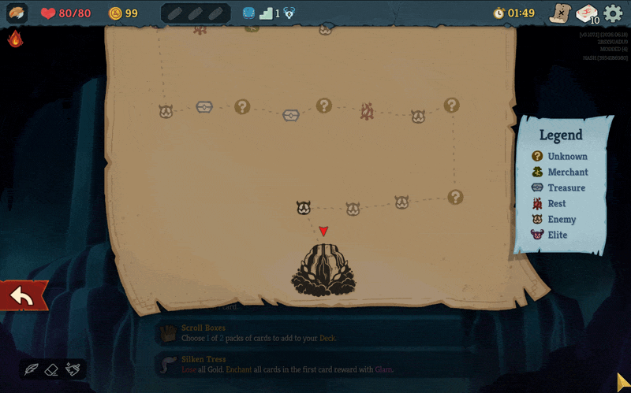
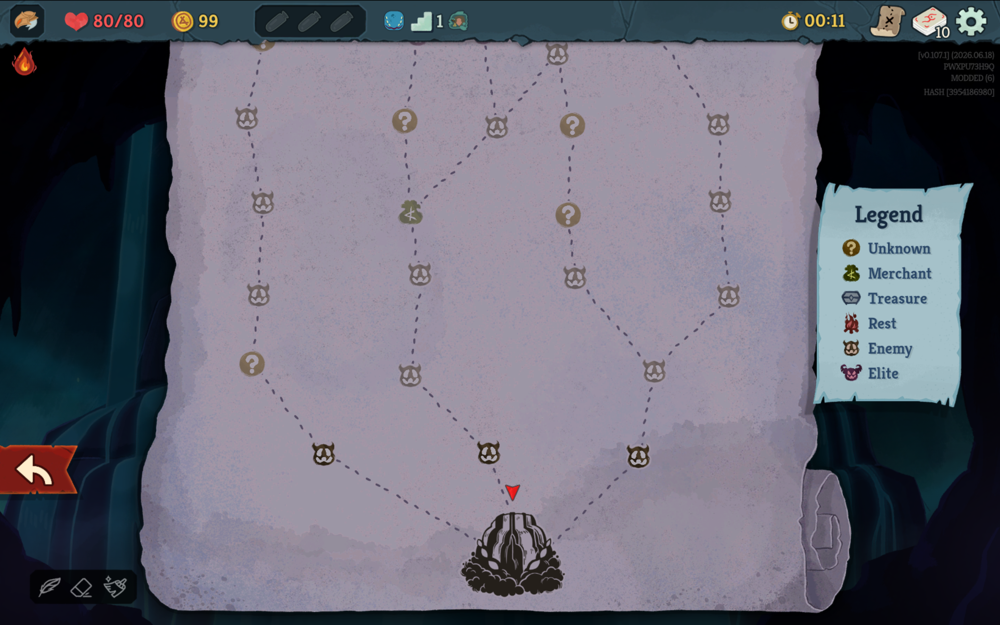
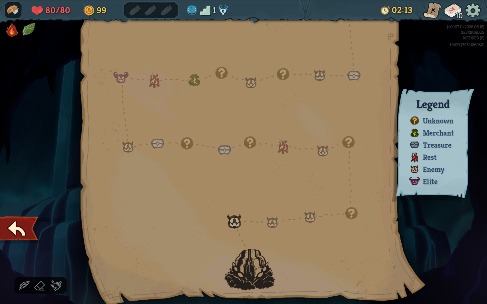

<div align="center">

# Wayfinder

A Slay the Spire 2 mod that turns each act's branching map into one long, reshuffled path.


[](https://github.com/Alchyr/BaseLib-StS2)



</div>

Why speedrun Slay the Spire 2 when you could take your time, see the sights, and enjoy the mysteries and encounters of the spire?

Wayfinder takes every point the game generated for an act and puts them all on one line, so you visit each combat, shop, chest, and rest site instead of picking a route past most of them. It doesn't join the existing paths end to end. It reshuffles the points and orders them with spacing rules, so you don't get two Elites back to back or five chests in a row.

> [!WARNING]
> v0.1.0 is still in development. The mod builds and its ordering tests pass, but nobody has played a full act with it yet. Expect bugs.

## What it does

- Each act gets its own unified path. Acts still start at their start point, usually the Ancient, and end at their boss.
- You never choose a direction. The next point is always the only one available.
- The map screen draws paths of 26 or more points as a switchback, running back and forth from the Ancient at the bottom center to the boss at the top center. Shorter paths keep the game's single column.
- The same seed always produces the same path.
- Golden Compass acts keep their 16-point golden path, which is already a straight line.

<!-- Replace with side-by-side screenshots of the same act, vanilla and Wayfinder. -->
| Vanilla | Wayfinder |
| :---: | :---: |
|  |  |

## How points are ordered

| Where | Rule |
| --- | --- |
| First point after the start | A Monster |
| Last point before the boss | A Rest site |
| Points 1 to 5 | No Elites, Rest sites, or Treasure |
| Elites | Spread across the act, with at least 2 other points between any two |
| Rest sites | Spread across the act, never back to back, and none in the two points before the last one |
| Shops | Spread across the act and never back to back |
| Treasure | Placed at random from point 6 on, at most 3 in a row |
| Monsters and Unknowns | At most 3 of each in a row |
| Monsters and Elites together | At most 4 in a row |

Some acts have a mix of points that can't meet every rule. When that happens, Wayfinder gives up rules in a fixed order, starting with the spread and the run limits on fights. Every point still goes on the path.

<!-- Replace with a screenshot of one act's full path, with its pacing visible. -->


## Changes beyond the map

An act with this many points would run through the game's encounter list and bring weak encounters back. Wayfinder runs change two things to account for the longer acts:

- Each act draws twice as many weak encounters, and its normal encounter list is twice the room count.
- Relics limited to before the Act 3 chest stop appearing when Act 3 starts, instead of at a fixed floor.

Wayfinder leaves combat stats, gold, and rewards alone.

## Install

You need Slay the Spire 2 version 0.107.0 or later and [BaseLib](https://github.com/Alchyr/BaseLib-StS2) 3.4.7 or later.

1. Create a `mods` folder in the game's install folder if it doesn't exist.
2. Download BaseLib and unpack it into `mods`.
3. Get Wayfinder and put it in `mods/sts2_wayfinder_mod/`. There is no public release yet, so [build it from source](#build-from-source) for now. <!-- Replace with a link to the release page once one exists. -->
4. Launch the game and choose to play modded.

The finished folder looks like this:

```
Slay the Spire 2/mods/
├── BaseLib/
└── sts2_wayfinder_mod/
    ├── sts2_wayfinder_mod.dll
    ├── sts2_wayfinder_mod.json
    └── sts2_wayfinder_mod.pck
```

Default Steam locations for the `mods` folder:

| OS | Path |
| --- | --- |
| Windows | `C:/Program Files (x86)/Steam/steamapps/common/Slay the Spire 2/mods/` |
| Linux | `~/.local/share/Steam/steamapps/common/Slay the Spire 2/mods/` |
| macOS | `~/Library/Application Support/Steam/steamapps/common/Slay the Spire 2/SlayTheSpire2.app/Contents/MacOS/mods/` |

## Settings

Wayfinder is on by default. To turn it off, use the Enable Wayfinder toggle in the mod's settings.

The toggle takes effect when you start a new run. A run in progress stays as it is, whether it has unified paths or not.

## Compatibility

- Wayfinder targets single-player. Co-op is untested, and the mod doesn't block it.
- Other mods that change the map are untested with Wayfinder.

## Build from source

You need the .NET 9 SDK, an installed copy of Slay the Spire 2, and MegaDot 4.5.1 to export the `.pck`. The game won't load a `.pck` from a newer Godot version.

Create `Directory.Build.props` in the repo root with your MegaDot path. Add `Sts2Path` as well if the build can't find the game.

```xml
<Project>
    <PropertyGroup>
        <GodotPath>/path/to/MegaDot_v4.5.1-stable_mono</GodotPath>
        <!-- <Sts2Path>/path/to/steamapps/common/Slay the Spire 2</Sts2Path> -->
    </PropertyGroup>
</Project>
```

`dotnet build` compiles the mod and copies the `.dll` and `.json` into the game's `mods` folder. `dotnet publish` also exports the `.pck`.

The ordering and layout tests run without the game:

```
dotnet test tests/OrderingTests
```

## More

- [Changelog](docs/changelog.md)
- [Terms used in this project](CONTEXT.md)
