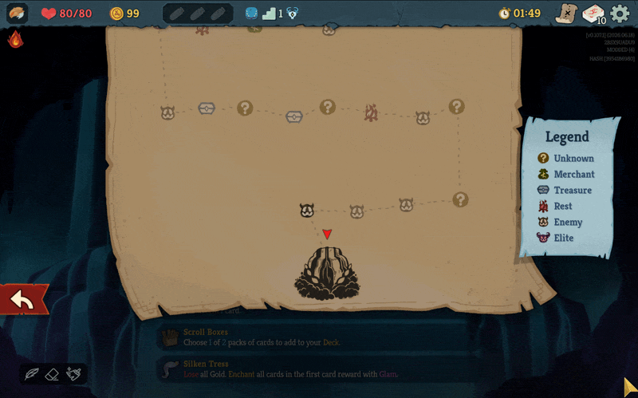
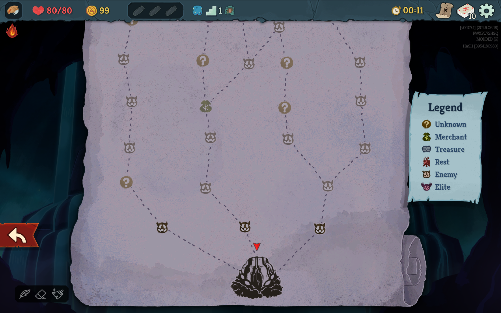
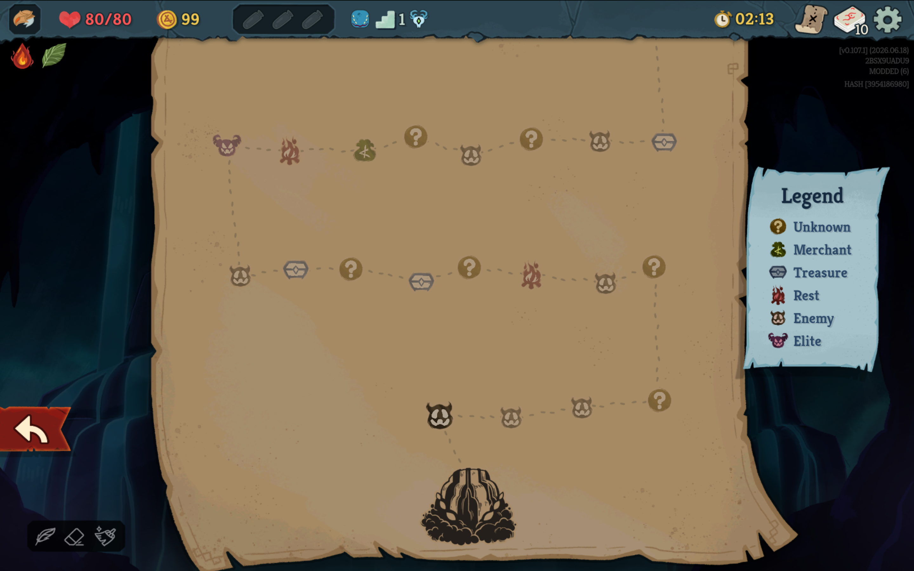
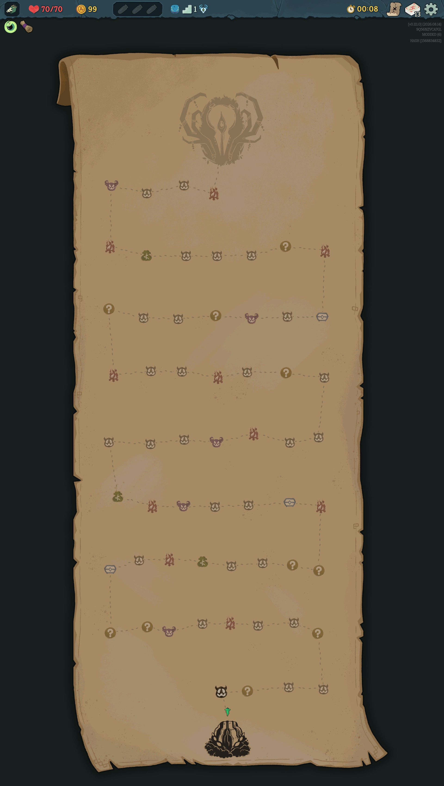

<div align="center">

# Wayfinder

A Slay the Spire 2 mod that turns each act's branching map into one long path with no choices.


[](https://github.com/Alchyr/BaseLib-StS2)



</div>

Why speedrun Slay the Spire 2 when you could take your time, see the sights, and enjoy the mysteries and encounters of the spire?

Wayfinder gives each act one line. You visit every combat, shop, chest, and rest site, instead of picking a route past most of them. The mod builds each act from a plan and places the points with spacing rules, so you never get two Elites back to back or five chests in a row.

> [!WARNING]
> v0.2.0 is still in development. The mod builds, its tests pass, and v0.2.0 was played through, but it has not had wide testing. Expect bugs.

## What it does

- Each act is one path. It still starts at the act's start point, usually the Ancient, and ends at the boss.
- You never choose a direction. The next point is always the only one.
- Paths of 26 or more points are drawn as a switchback. It runs back and forth from the Ancient at the bottom center to the boss at the top center. Shorter paths stay in the game's single column.
- The same seed always makes the same path.
- By default, each act has its own length and mix of points. See [Act plans](#act-plans).
- Golden Compass acts keep their 16-point golden path, which is already a straight line.

<!-- Replace with side-by-side screenshots of the same act, vanilla and Wayfinder. -->
| Vanilla | Wayfinder |
| :---: | :---: |
|  |  |

## Act plans

By default, the run seed picks each act's length and how many points of each type it has, within the ranges below. The game's own map only gives the start point and the boss. Monsters fill whatever room is left.

| | Act 1: Build the deck | Act 2: The wilds | Act 3: The gauntlet |
| --- | --- | --- | --- |
| Length | 34 to 38 | 32 to 36 | 26 to 30 |
| Elites | 3 to 4 | 3 to 5 | 4 to 6 |
| Unknowns | 3 to 5 | 8 to 12 | 2 to 4 |
| Rest sites | 5 to 6 | 4 to 5 | 3 to 4 |
| Shops | 2 | 3 | 1 |
| Treasures | 2 | 1 to 2 | 1 |

- **Act 1, Build the deck.** Fights and card rewards help you grow. Unknowns are rare, Elites come later and are spaced out, and there are plenty of rest sites. Two shops let you trim your deck.
- **Act 2, The wilds.** It has the most Unknowns and the most shops, and the number of Elites varies the most. Unknowns can come 2 to 3 in a row.
- **Act 3, The gauntlet.** It is the shortest act and has the most Elites for its size. It has one shop and one treasure. Two Elites can sit side by side, but never three.

A run is about 96 points, against 157 for the full map. To keep every point the game makes, set **Path length** to **Full map**, as in v0.1.

## How points are ordered

| Where | Rule |
| --- | --- |
| First point after the start | A Monster |
| Last point before the boss | A Rest site |
| Points 1 to 5 | No Elites, Rest sites, or Treasure |
| Elites | Spread across the act, with at least 2 other points between any two. In Act 1, none in the first third of the path, and at least 5 points between any two. In Act 3, two Elites can sit side by side as a pair. A Rest site comes right before the pair, and no other Elite is within 4 points on either side |
| Rest sites | Spread across the act, never back to back, and none in the 2 points before the last one |
| Shops | Spread across the act, never back to back |
| Treasure | Placed at random from point 6 on, at most 3 in a row |
| Monsters and Unknowns | At most 3 of each in a row |
| Monsters and Elites together | At most 4 in a row |

Some acts have a mix of points that can't meet every rule. When that happens, Wayfinder drops rules in a fixed order. It starts with the spacing rules and the limits on fights in a row. Every point still goes on the path.

### Example Map


## Encounters

A longer act would use up the game's list of encounters and bring weak ones back late. Wayfinder changes three things to prevent that:

- Each act gets twice as many weak encounters. With the default path length, the normal encounter list is as long as the act can need. With Full map, it is twice the number of rooms.
- When an act's list runs out, fights stay random instead of replaying the list. Each Elite is a random pick that skips the one you just fought. Each late normal fight is a random regular encounter, never a weak one. The same Elite or fight never comes twice in a row.
- Relics that must appear before the Act 3 chest stop appearing when Act 3 starts, instead of at a fixed floor.

## Install

You need Slay the Spire 2 version 0.107.0 or later and [BaseLib](https://github.com/Alchyr/BaseLib-StS2) 3.4.7 or later.

1. Create a `mods` folder in the game's install folder if it isn't there.
2. Download BaseLib and unpack it into `mods`.
3. Download the latest zip from the [releases page](https://github.com/atendev/sts2-wayfinder-mod/releases) and unpack it into `mods`. On the `public-beta` game branch, take the newest prerelease whose version ends in `-beta.N` instead. You can also [build it from source](#build-from-source).
4. Launch the game and choose to play modded.

The finished folder looks like this:

```
Slay the Spire 2/mods/
├── BaseLib/
└── sts2_wayfinder_mod/
    ├── sts2_wayfinder_mod.dll
    ├── sts2_wayfinder_mod.json
    └── sts2_wayfinder_mod.pck
```

Default Steam locations for the `mods` folder:

| OS | Path |
| --- | --- |
| Windows | `C:/Program Files (x86)/Steam/steamapps/common/Slay the Spire 2/mods/` |
| Linux | `~/.local/share/Steam/steamapps/common/Slay the Spire 2/mods/` |
| macOS | `~/Library/Application Support/Steam/steamapps/common/Slay the Spire 2/SlayTheSpire2.app/Contents/MacOS/mods/` |

## Settings

Wayfinder is on by default. To turn it off, use the Enable Wayfinder toggle in the mod's settings.

Settings take effect when you start a new run. A run already in progress keeps the settings it started with.

**Path length** is either Acts (the default) or Full map. Every difficulty preset uses Acts.

### Difficulty

A shorter path gives you fewer fights and rewards, so Wayfinder also makes runs harder. A dropdown under Enable Wayfinder sets the preset. Power curve is the default.

| Preset | What it does |
| --- | --- |
| Off | Vanilla numbers, as in v0.1. |
| Bosses only | Bosses get more HP and damage. Nothing else changes. |
| Power curve | Enemies get stronger through Acts 2 and 3, and rewards are smaller, so Act 3 is the hardest part. |
| Custom | Shown when you change an option away from its preset. |

The options under the dropdown:

- **Enemy scaling.** Toggles for boss scaling and for HP and damage scaling along the path. Scaled attack damage shows in the enemy's intent.
- **Card rewards.** Alternate card rewards skips the card reward on every second normal combat. Card choices sets how many cards a reward offers.
- **Treasure chests.** Each chest is either a relic chest or a gold chest. You can set the odds.
- **Elite relics.** Lower Elite relic rarity makes an Elite's relic more likely to be Common.
- **Gold rate.** Lean, Vanilla, or Rich changes every gold gain.

When a run ends, Wayfinder saves the settings it used to `history/wayfinder/<start_time>.json`, next to the run history.

## Compatibility

- Wayfinder ships in two builds. The stable build runs on the normal game branch. The beta build runs on the `public-beta` branch and won't load on the normal one. Use the build that matches your game branch.
- Wayfinder is made for single-player. Co-op is untested, and the mod doesn't block it.
- Other mods that change the map are untested with Wayfinder.

## Build from source

You need the .NET 9 SDK, an installed copy of Slay the Spire 2, and MegaDot 4.5.1 to export the `.pck`. The game won't load a `.pck` from a newer Godot version.

Create `Directory.Build.props` in the repo root with your MegaDot path. Add `Sts2Path` too if the build can't find the game.

```xml
<Project>
    <PropertyGroup>
        <GodotPath>/path/to/MegaDot_v4.5.1-stable_mono</GodotPath>
        <!-- <Sts2Path>/path/to/steamapps/common/Slay the Spire 2</Sts2Path> -->
    </PropertyGroup>
</Project>
```

`dotnet build` compiles the mod and copies the `.dll` and `.json` into the game's `mods` folder. `dotnet publish` also exports the `.pck`.

The ordering and layout tests run without the game:

```
dotnet test tests/OrderingTests
```

## More

- [Changelog](docs/changelog.md)
- [Terms used in this project](CONTEXT.md)

## Releasing

Wayfinder has two release channels. Stable versions (`vX.Y.Z`) are released from `main` for the normal game branch. Beta versions (`vX.Y.Z-beta.N`) are released from the `beta` branch for the game's `public-beta` branch, with `min_game_version` set to that beta's game version. Merge `main` into `beta` to carry shared changes over.

1. Change `version` in `sts2_wayfinder_mod.json`.
2. Add a matching `## vX.Y.Z` or `## vX.Y.Z-beta.N` section to `docs/changelog.md`.
3. Merge to `main`, or to `beta` for a beta version.
4. Run `scripts/release.sh` from that branch, then `scripts/release.sh --mode workshop`.

The script runs the tests, builds the `.pck`, zips the mod, tags the version, and publishes a GitHub release with the changelog section as notes. A beta version is published as a prerelease, uploads to its own Workshop item from `dist/workshop-beta`, and goes to its own Nexus file. Use `--dry-run` to build the zip without tagging. The build needs the game's files, so it runs on your machine, not in CI.

## License

Wayfinder is released under the [MIT License](LICENSE).
